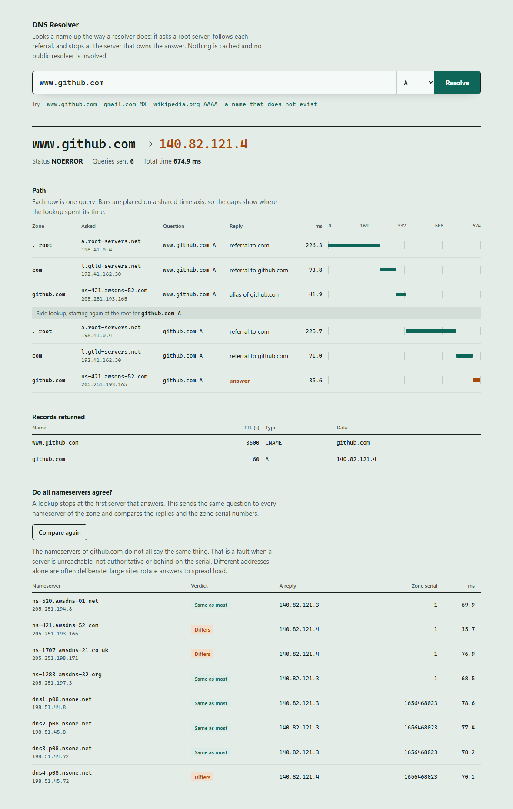

# DNS Resolver from Scratch

An iterative DNS resolver written in pure Python. It builds and parses DNS packets by hand
(RFC 1035), starts at a root server and follows referrals down to the authoritative server,
the same walk a real recursive resolver performs. It never forwards the question to
`8.8.8.8` or to the operating system.

It can also do something a normal lookup cannot: ask **every** nameserver of a zone the same
question and show where they disagree.

No dependencies. Only the Python standard library.



## What it does

- Encodes queries and decodes responses at the byte level, including name compression pointers
- Walks root → TLD → authoritative servers and records every hop with its latency
- Compares all nameservers of a zone: their answers, whether they are authoritative, and
  their zone serial numbers (`--audit`)
- Records servers that did not reply, so the trace shows what a timeout cost
- Follows `CNAME` chains and resolves nameservers that come without glue records
- Falls back to TCP when a UDP response is truncated
- Supports `A`, `AAAA`, `NS`, `CNAME`, `MX`, `TXT` and `SOA`
- Ships with a command line tool and a small local web UI

## Usage

Requires Python 3.10 or newer.

```bash
python dnsresolver.py www.github.com
```

```
 1. www.github.com A   @ a.root-servers.net (198.41.0.4) [.]              254.9 ms  -> referral to com
 2. www.github.com A   @ l.gtld-servers.net (192.41.162.30) [com]          70.7 ms  -> referral to github.com
 3. www.github.com A   @ ns-421.awsdns-52.com (205.251.193.165) [github.com] 44.6 ms  -> alias of github.com
 4.   github.com A     @ a.root-servers.net (198.41.0.4) [.]              242.1 ms  -> referral to com
 5.   github.com A     @ l.gtld-servers.net (192.41.162.30) [com]          72.4 ms  -> referral to github.com
 6.   github.com A     @ ns-421.awsdns-52.com (205.251.193.165) [github.com] 32.5 ms  -> answer

NOERROR
www.github.com  3600  CNAME  github.com
github.com      60    A      140.82.121.3
```

Other record types:

```bash
python dnsresolver.py gmail.com MX
```

Compare every nameserver of the zone:

```bash
python dnsresolver.py github.com --audit
```

```
github.com A as seen by every nameserver of github.com

  ns-520.awsdns-01.net     ok   serial 1           67.0 ms  140.82.121.3
  ns-421.awsdns-52.com     ok   serial 1           34.0 ms  140.82.121.3
  ns-1707.awsdns-21.co.uk  ok   serial 1           72.0 ms  140.82.121.4  differs from the majority
  dns1.p08.nsone.net       ok   serial 1656468023  74.8 ms  140.82.121.3
  dns3.p08.nsone.net       ok   serial 1656468023  78.9 ms  140.82.121.4  differs from the majority
  ...
differences found
```

The exit code is 0 when all servers agree and 1 when they do not, so it can run in a script.

Web UI:

```bash
python web.py
```

Then open <http://127.0.0.1:8053>. The server listens on the loopback interface only.

## How it works

1. **Ask a root server.** The query is sent with the "recursion desired" flag off, so the
   server answers only what it knows. A root server does not know `www.github.com`, but it
   knows who runs `com` and replies with a *referral*: a list of nameservers plus their
   IP addresses (glue records).
2. **Follow the referral.** The same question goes to a `com` server, which refers to the
   `github.com` nameservers.
3. **Get the answer.** The authoritative server returns the record, or a `CNAME` that
   restarts the walk for the new name.

## Details that were not obvious

- **A successful lookup hides broken servers.** A resolver stops at the first nameserver
  that answers. If one of four servers is down, not authoritative for the zone (a "lame
  delegation") or still serving last week's zone file, most lookups still succeed and nobody
  notices. The audit asks all of them and compares the replies and the SOA serial.
- **Different answers are not always a fault.** The real output above shows it: GitHub runs
  two DNS providers with unrelated serial schemes, and its servers rotate between two
  addresses to spread load. The tool therefore reports differences and leaves the verdict to
  the reader. Unreachable and non-authoritative servers are the findings that are always bad.
- **One lost packet must not condemn a server.** The audit sends two questions per server.
  If the answer arrives but the serial query is lost, the server is reported as working with
  an unknown serial, not as unreachable. A test covers exactly this case.
- **Timeouts belong in the trace.** A silent server costs a full timeout before the next one
  is tried. Those attempts are recorded as their own rows, otherwise the total time would be
  larger than the sum of the steps shown.
- **Compression pointers can loop.** A name in a DNS packet may point back to an earlier
  offset. A malformed packet can point at itself, so the parser limits the number of jumps.
- **Referrals must make progress.** A referral is accepted only if it points to a zone that
  is deeper than the current one and contains the name being resolved. Otherwise two
  misconfigured servers could bounce the resolver between them forever.
- **Glueless delegations.** Some referrals name a nameserver without giving its address. The
  resolver then pauses, resolves the nameserver's own name from the root, and continues.
- **Truncation.** When a response does not fit in a UDP datagram the server sets the `TC`
  bit, and the query is repeated over TCP with a two byte length prefix.
- **Replies are matched to queries.** Each query uses a random 16 bit ID and a connected UDP
  socket, so packets from other hosts or with the wrong ID are rejected.

## Tests

The tests run offline. Packets are assembled byte by byte and the network is replaced with a
fake DNS tree, so referral loops, CNAME loops, timeouts and malformed packets can be tested
deterministically. The audit is tested against a zone with four nameservers: one in sync, one
with an old serial, one that is not authoritative and one that never replies. 19 tests.

```bash
python -m unittest -v
```

## Limitations

- No caching, so every lookup starts at the root. This keeps the trace complete but slow.
- No DNSSEC validation and no EDNS(0).
- Queries go to IPv4 nameservers only (`AAAA` records can still be looked up).

## License

MIT
